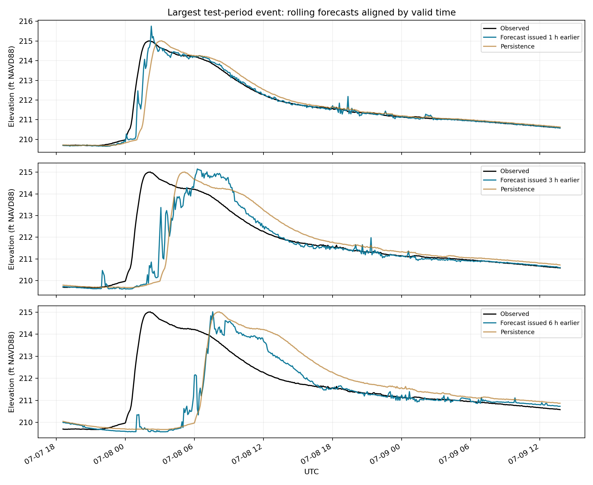

# Crabtree Creek — peak-focused water-level forecasting

**Johann Alexander Vera Mercado** · Civil engineer and hydrologist · [ORCID](https://orcid.org/0000-0001-9594-5960)

A reproducible research project for forecasting **water-surface elevation 1–6 hours ahead** at USGS **02087275, Crabtree Creek at Hwy 70, Raleigh, NC**. It uses approximately five years of five-minute observations, preserves real flood peaks, and reports high-water and event diagnostics alongside average error.

**v0.1 is a trained gradient-boosting benchmark plus corrected optional neural experiments. It is not a validated operational warning system.** The original notebook explored LSTM, GRU and BiLSTM; it did not supply comparable original-model results on this dataset. No claim of superiority over the original neural model is made.

## Run locally or in Colab

Use Python 3.11. Download the repository or clone it, change into its directory, then:

```bash
pip install -r requirements.txt
python download_data.py
python -m unittest test_integrity.py
OMP_NUM_THREADS=2 python forecast.py
python evaluate_events.py
```

Open `Crabtree_Forecasting.ipynb` for a guided walkthrough. The repository also includes `Crabtree_Forecasting_v0_1.zip`: extract it to recover the exact raw snapshots, fitted models and detailed test predictions used in this run. After fitting, `python predict_latest.py` issues six forecasts from the latest local observation; it does not fetch live data or send alerts. Six saved models, detailed predictions, evaluation tables and an event plot are written under `results/`. Runtime depends on the machine; the benchmark was run on CPU. The CSV and PNG files at the repository root are **the initial run's report snapshots**; subsequent runs write to `results/`.

## Data and units

Source: user-provided USGS NWIS RDB exports, retrieved October 11, 2026. `sources.json` records URLs and SHA-256 hashes. Five overlapping annual exports cover October 4, 2021 to October 11, 2026, 20:15 EDT.

| Field | Meaning |
|---|---|
| `301102_63160` | Water-surface elevation, feet above NAVD 1988 |
| `89142_00045` | Precipitation, total, inches |
| `_cd` | USGS approval/provisional qualification |
| `datetime`, `tz_cd` | Local timestamp with EST/EDT offset |

There is **no discharge column**. Elevation is not river depth or gauge height. Discharge requires additional observations or a verified, applicable rating relation; do not infer it from these elevations alone.

527,642 unique timestamps remain after removing 9,216 overlapping rows; overlapping numerical values agree. Reindexing to a complete five-minute UTC grid inserts 506 missing timestamps. The resulting grid has 566 missing elevation values and 24,454 missing rainfall values, including inserted rows. Missing rainfall is never filled with zero. Data qualifiers are retained, including provisional observations. USGS data may be revised.

Rain features use trailing sums of reported precipitation values. **Confirm the sensor's reporting interval and reset/accumulation convention before interpreting them as physical accumulation or extending to other gauges.** This version treats the supplied readings as interval totals; it does not infer basin-average rainfall from a point gauge.

## Hydrologic inputs

Only information available at forecast issue time is used:

- Current elevation and elevation lags from 5 minutes to 24 hours.
- Elevation changes over those intervals, capturing the rising limb and recession.
- Current rain and trailing precipitation summaries over 15 minutes to 24 hours.
- Missing-rain fractions to retain information about observation availability.

Targets remain unsmoothed. No z-score removal of peaks is applied. Missing historical features remain NaN; the tree model handles missing features natively. Cases with missing current elevation or an incomplete future observation path are excluded. Measurement errors are not automatically classified as real floods: further station quality review is needed.

## Training and calibration

Six direct models predict elevation change at 12, 24, 36, 48, 60 and 72 five-minute steps. The observed current elevation is then added back to give forecasts in feet NAVD88.

| Split | UTC boundaries |
|---|---|
| Training | Start through October 4, 2024, exclusive |
| Validation | October 4, 2024 through October 4, 2025, exclusive |
| Test | October 4, 2025 onward |

Targets crossing training/validation boundaries are excluded; future rain or future level is never an input. This is a chronological split, **not an explicit storm-disjoint split**: events crossing boundaries should be separately audited before a stronger validation claim.

For CPU efficiency, training origins are sampled every 30 minutes. Historical input observations and targets remain at five-minute resolution. Validation and testing use every eligible five-minute origin. The training elevation's 95th percentile defines a **research high-water threshold**, not an official flood warning level. High-water targets receive weight 4. Two tree sizes (15 and 31 leaves) are selected using weighted validation MAE; test data are not used to select them. No scaling is needed for the tree model.

## Initial held-out results

Test period: October 2025–October 2026. All errors below are in feet. Persistence predicts the current elevation at every future horizon.

| Horizon | Persistence MAE | Model MAE | Persistence high-water MAE | Model high-water MAE |
|---|---:|---:|---:|---:|
| 1 h | 0.0284 | 0.0201 | 0.3238 | 0.1907 |
| 2 h | 0.0525 | 0.0466 | 0.6010 | 0.4464 |
| 3 h | 0.0732 | 0.0706 | 0.8076 | 0.6217 |
| 4 h | 0.0914 | 0.0951 | 0.9864 | 0.7905 |
| 5 h | 0.1081 | 0.1118 | 1.1456 | 0.9443 |
| 6 h | 0.1231 | 0.1306 | 1.2982 | 1.0663 |

The model improves high-water MAE at every horizon but global MAE worsens at 4–6 hours. At 3–6 hours global RMSE also worsens. Overall MAE is dominated by quiet periods and is insufficient for warning assessment.

Research threshold: **210.87 ft NAVD88**, computed only from training observations. Pointwise threshold recall/precision are approximately 97.0%/95.7% at 1 hour and 78.8%/71.4% at 6 hours. These count correlated five-minute points, **not independent flood detections**, and do not establish useful warning lead time.

`evaluate_events.py` identifies test exceedance groups separated by more than six hours and examines windows expanded six hours on each side. Nine candidate events were found; eight have complete windows for all six horizons. Signed peak magnitude and timing errors are reported. This grouping can merge multiple peaks and needs hydrologist review. The plot assembles rolling forecasts by their valid times; it is **not a trajectory issued six hours before an event**. Persistence reproduces a peak's height after a delay, explaining why peak amplitude alone can be misleading.



## Neural comparison with the original approach

`neural_models.py` supplies corrected optional LSTM, GRU and BiLSTM experiments with 6-hour historical sequences, six direct hourly outputs, training-only input and target scaling, proper inverse transformation, chronological splits, and restored best validation weights.

```bash
pip install -r requirements-neural.txt
python neural_models.py --kind gru --epochs 30
# --kind lstm or --kind bilstm
```

**Neural training was not run in v0.1** because TensorFlow was unavailable in the execution environment. Syntax was checked. Neural experiments exclude incomplete input sequences and use 30-minute origins, so their evaluation population differs from the tree benchmark: align common timestamps before comparing. BiLSTM reads only the historical input window, not future observations. Six hourly endpoints do not resolve all peaks within a six-hour forecast trajectory.

## Next hydrologic improvements

1. Confirm precipitation semantics; add upstream gauges, basin-average radar rain and issue-time archived rainfall forecasts.
2. Review independent storm events, channel changes, sensor history, drainage area and response time.
3. Supply official elevation thresholds in the same datum and evaluate first warning issue time, missed events, false alarm episodes and alert persistence.
4. Train full five-minute future trajectories, asymmetric peak losses and calibrated prediction intervals. Compare against the present benchmark without repeatedly tuning on this test year.
5. Add discharge only with observed discharge data or a verified rating relation, accounting for changes and possible hysteresis.

## References

- [USGS station](https://waterdata.usgs.gov/monitoring-location/USGS-02087275/)
- [USGS data qualification](https://waterdata.usgs.gov/provisional-data-statement/)
- [scikit-learn model documentation](https://scikit-learn.org/stable/modules/generated/sklearn.ensemble.HistGradientBoostingRegressor.html)
- Exact retrieval links are in `sources.json`.


## Newark reservoir project moved

Modules 6 (Canistear) and 7 (Oak Ridge), together with their GIS datasets and maps, now live in [newark-water-supply](https://github.com/JohannVera/newark-water-supply). Follow that repository for current notebooks and Colab links. This repository remains focused on Crabtree flood forecasting.
